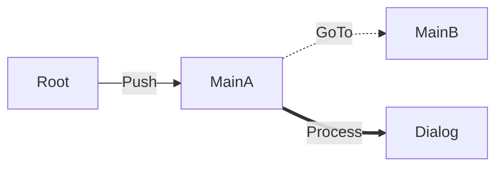

# 拡張とツール

## ステートの生成

DI コンテナを使う場合など、ステートの作り方を変えたいときは、`IStateFactory` を `Config.Factory` に設定します。

```cs
public interface IStateFactory
{
	(T State, IDisposable Value) Create<T>(
		in StateCreationContext context, IDisposable parent) where T : GameState;
}
```

戻り値の `Value` には2つの役割があります。

- 子のステートを作るとき、`parent` として渡される
- そのステートが終了するときに破棄される

DI のスコープのように「このステートのために作り、子にも渡したいもの」を扱えます。
破棄の登録はライブラリが作成直後に行うので、登録し忘れることはありません。

**`parent` をそのまま返さないでください。** 子が終了したときに、親のものが破棄されてしまいます。
子に渡したいだけなら、何もしない `Dispose` を持つ入れ物に包んで返してください。

```cs
sealed class Node : IDisposable
{
	public IServiceProvider Provider { get; }
	readonly IDisposable m_Scope;          // スコープを作らなかったときは null

	public Node(IServiceProvider provider, IDisposable scope = null)
	{
		Provider = provider;
		m_Scope = scope;
	}

	public void Dispose() => m_Scope?.Dispose();
}

class ScopeFactory : StateFactory<Node>
{
	protected override (T State, Node Value) Create<T>(in StateCreationContext c, Node parent)
	{
		var provider = parent?.Provider ?? m_Root;

		if (typeof(IScopeOwner).IsAssignableFrom(typeof(T)))
		{
			var scope = provider.CreateScope();
			return (Resolve<T>(scope), new Node(scope.ServiceProvider, scope));
		}
		return (Resolve<T>(provider), new Node(provider));
	}
}
```

それぞれのステートが「子に渡す値」を返すので、親をたどって探す必要はありません。

`StateFactory<TValue>` は `Value` の型を決めて書ける基底クラスです。`IStateFactory` を直接実装しても構いません。

### DI コンテナを使うとき

特定のコンテナは推奨していません。仕組みはコンテナに依存しないので、プロジェクトの事情で選んでください。

**ビルド時のコード削除（ストリッピング）に注意してください。**
リフレクションでコンストラクタを探すコンテナでは、使われていないと判断されたコンストラクタが削除されます。
書いていない引数なしのコンストラクタも削除されます。

| 対象 | 対処 |
| --- | --- |
| `Push` / `GoTo` の遷移先 | 不要。削除されないためのコードが自動で生成される（`GSS_DISABLE_CONSTRUCTOR_PRESERVE` で止められる） |
| `Arg` を付けたプロパティ | 不要。`Arg` は `PreserveAttribute` を継承している |
| それ以外の型（サービスの実装、コンストラクタ引数の型など） | 必要。`[Preserve]` や `link.xml` で残す |

## 観測とツール

### ステート木を取得する

実行中のステートの親子関係を取得できます。

```cs
var list = new List<StateTreeNode>();
manager.GetTree(list);          // 親が先の順。Depth に深さが入る
foreach (var node in list)
{
	Debug.Log($"{new string(' ', node.Depth * 2)}{node.State.GetType().Name}");
}

manager.GetParent(state);              // 親
manager.GetChildren(state, children);  // 直接の子だけ
Debug.Log(manager.DumpTree());         // 木を文字列にする
```

`FindAllStates` は親子関係を持たない一覧で、`Active` でないステートを含みません。
木の形を見たいときは、`Active` でないステートも含む `GetTree` を使ってください。

### 遷移を監視する

`IStateObserver` を登録すると、遷移が起きるたびに通知を受け取れます。

```cs
class TransitionLogger : IStateObserver
{
	public void OnStateEvent(in StateEvent e) => Debug.Log(e.ToString());
}

manager.AddObserver(new TransitionLogger());
```

| StateEventType | 内容 |
| --- | --- |
| `Enter` | ステートが始まった |
| `Exit` | ステートが終了した（理由は `Reason`） |
| `ForceRelease` | `Entry` のやり直しで解放された |
| `Error` | 遷移が失敗した |

- 登録は `Entry` をやり直しても消えません。やり直しによる解放も通知するためです。
- 通知を受けた側で例外が出ても、遷移は続きます（例外はログに出ます）。

### EditorWindow

`Window > GameStateStructure > State Viewer` で、実行中のステート木と遷移の履歴を表示します。再生中だけ動きます。

- ステート名をクリックすると、そのステートの `ContextObject` を Hierarchy で選択します。
- 遷移の履歴は新しいものから200件まで残ります。

### Editor からイベントを実行する

`SubscribeEvent` を付けた関数は、EditorWindow から直接実行できます。デバッグ用の仕組みを別に作る必要はありません。

```cs
[SubscribeEvent]
public interface IReboot
{
	void Reboot();
}

[GoTo(typeof(InGameScene))]
partial class TitleScene : GameState, IReboot
{
	void IReboot.Reboot() => GoToTitleScene<TitleScene>();

	// 子からは呼ばず、直接の呼び出しとツールからの実行だけで使う
	[SubscribeEvent(Internal = true, Transition = typeof(InGameScene))]
	public void DebugGoInGame() => GoToInGameScene<InGameScene>();
}
```

| プロパティ | 内容 |
| --- | --- |
| `Internal` | `true` にすると、呼び出し用の関数を生成しない。ツールと直接の呼び出しだけで使う |
| `Transition` | このイベントで遷移する先。遷移図やツールが表示に使う情報で、動作には影響しない |

`void IReboot.Reboot()` のような明示的なインターフェース実装も実行できます。

引数のあるイベントは、EditorWindow に入力欄が出ます。使える型は `bool` / `int` / `float` / `string` / `enum` です。
それ以外の型があると実行ボタンが押せなくなり、理由が表示されます。

複雑な引数を持つイベントは普通にあるので、既定では警告しません。
すべてのイベントをツールから実行できるようにしたいときは、`GSS_STRICT_EVENT` を定義してください。警告（GSS0023）が出るようになります。

### 遷移図

`Window > GameStateStructure > Transition Diagram` で、宣言された遷移を mermaid 形式で出力します。
実行しなくても全体の流れを確認できます。



| 線 | 意味 |
| --- | --- |
| 実線 | `Push` |
| 破線 | `GoTo` |
| 太線 | `IProcess` |

`TransitionDiagram.GenerateMermaid` は public です。CI で出力の差分を確認する用途にも使えます。
出力の内容は、ソースの並び順に左右されません。

## ログ

ログはビルド時に取り除かれます。出力するには Scripting Define Symbol を設定してください。
設定していないと、`Log.Level` や `Log.Handler` を変えても何も出ません。

| Define | 出力されるレベル |
| --- | --- |
| `GSS_LOG_ALL` | すべて |
| `GSS_LOG_TRACE_OR_HIGHER` | Trace 以上 |
| `GSS_LOG_DEBUG_OR_HIGHER` | Debug 以上 |
| `GSS_LOG_INFO_OR_HIGHER` | Info 以上 |
| `GSS_LOG_WARNING_OR_HIGHER` | Warning 以上 |
| `GSS_LOG_ERROR_OR_HIGHER` | Error だけ |

出力先を変えたいときは、`ILogHandler` を実装して `Log.Handler` に設定します。
